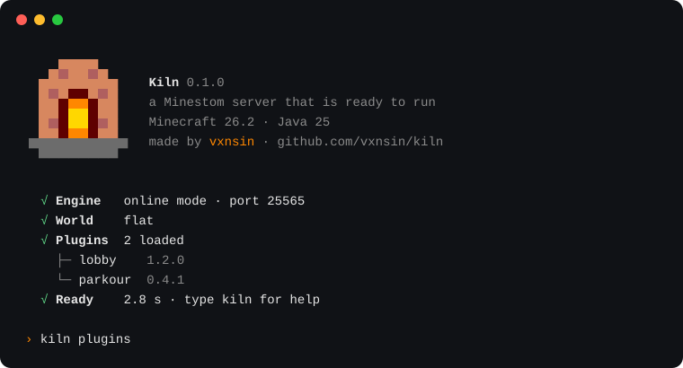
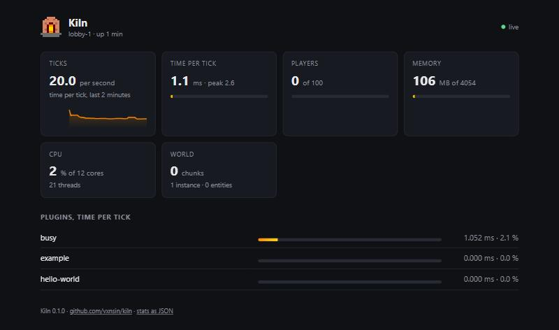

<p align="center">
  
</p>

<p align="center">
  A Minestom server that is ready to run. Start the jar, drop in plugins, done.
</p>

---

[Minestom](https://minestom.net) is a library, not a server. Before your first player joins you write a main
class, a console, commands, a config file, a plugin loader and somewhere to keep player data. Kiln is that
part, written once, so a new project starts at the interesting bit.

<p align="center">
  
</p>

On the machine it was written on, an empty Kiln starts in about three seconds and uses around 100 MB of
memory.

## What is in the box

### While you build

- **Plugins you can swap while it runs.** Replace a jar in `plugins/` and the new build takes over within a
  second, no restart and no command. Delete one and it is unloaded, add one and it is loaded. Player data is saved
  in between, and a build that fails to start leaves the previous version running.
- **A plugin project in one line.** `java -jar kiln.jar new my-plugin` creates a Gradle project that builds
  straight into the running server. Save, build, and the change is live.
- **Which plugin is slow.** `/kiln performance` and the dashboard show the time each plugin spends per tick,
  slowest first, next to tick time, memory, CPU and the world.
- **A profiler built in.** `/kiln profile 30` watches the server threads for thirty seconds and names the
  methods that cost the most time, and the plugins they belong to.
- **Player data in one line.** A value per player, loaded while they connect, saved when they leave and every
  five minutes in between.
- **Every player in their own language.** Put `lang/en.yml`, `lang/de.yml` and so on into a plugin and each
  player gets the file that matches their Minecraft language.

### While it runs

- **A console worth looking at.** A pixel icon, every startup step with a spinner, plugins as a tree, and a
  prompt with history and tab completion.
- **One command for the server itself.** Everything lives under `/kiln`, so plugins keep the rest of the command
  space. Kick with a reason, announce, or stop after a countdown everyone can see.
- **A live dashboard.** Turn on `web-port` and open it in a browser: ticks, memory, CPU, players and plugins,
  updated every two seconds.
- **Permission groups.** Groups with inheritance and wildcards in `permissions.yml`. Every `/kiln` command has
  its own permission, so a moderator can run maintenance without becoming operator.
- **Bans and mutes with a reason and an end.** `/kiln ban griefer 7d broke the spawn` keeps someone out with a
  clean screen that says why and until when. With Redis, a ban counts on every server.
- **Maintenance and whitelist.** `/kiln maintenance on` (or `/kiln whitelist on`) lets in only operators and the
  players you allow. The server list says so, and the setting survives a restart.
- **Your name on it.** Server name and two colors in `kiln.yml` are used by every chat message, every disconnect
  screen, and the tab list. Chat lines, join and leave messages show group prefixes from `permissions.yml` and can
  each be restyled or switched off. Kiln's own screens speak English or German, following `language` in
  `kiln.yml`.
- **Honest while starting.** The port opens first. Whoever joins too early gets a clean "still starting" screen
  instead of a timeout.
- **A face in the server list.** The kiln pixel icon by default, or your own `server-icon.png`.
- **A resource pack without a web host.** Drop `pack.zip` next to the server and it is sent to everyone who
  joins.

### When there are many

- **Worlds from files.** Drop a world saved in singleplayer or on a Paper server into `worlds/`. Every `open`
  hands out a fresh copy that is never written back, so each round starts on the same map.
- **Storage you can switch.** JSON files by default, Redis, Valkey, Dragonfly or MongoDB with one line in
  `kiln.yml`. No plugin has to change for it.
- **Servers that know each other.** With Redis as storage, Kiln servers find each other: `/kiln servers` lists
  all of them with their players, `/kiln find <player>` says where someone is, and plugins send messages to
  themselves on every other server.
- **A network without a proxy.** Give each server a `public-address` and `/kiln send <player> <server>` moves
  players between them with Minecraft's own transfer. Plugins do the same with `kiln.network().send`.
- **Behind a proxy.** Put your Velocity forwarding secret into `kiln.yml`.
- **Made for containers.** Every setting can come from an environment variable, there is a health check, a
  Dockerfile, and a server can shut itself down when the round is over.

Kiln sits on top of Minestom and does not fork it. Events, commands, instances and entities are plain
Minestom, so its documentation applies unchanged.

<p align="center">
  
</p>

## When Kiln fits

Kiln is for servers that are a game rather than a world: lobbies, minigames, event servers, parkour,
training and learning maps. They do not need survival mechanics. They need to start fast, stay small and be
put together from parts.

- **A server per round.** Three seconds and 100 MB make it practical to start a fresh server for every match and
  throw it away afterwards, instead of resetting a long-running one.
- **Parts instead of one binary.** With plain Minestom every game is its own program. With Kiln a lobby, a game
  mode and a stats plugin are three jars you combine per server.
- **Data that is just there.** Coins, stats and settings per player without writing load and save code.

If you want survival with mobs, farms and redstone, use [Paper](https://papermc.io). Minestom has none of
that built in, and neither has Kiln.

## Run it

You need Java 25. Build the jar:

```bash
git clone https://github.com/vxnsin/kiln
```

```bash
cd kiln
```

```bash
./gradlew :server:jar
```

The result is `server/build/libs/kiln-0.1.0.jar`. Put it in an empty folder and start it:

```bash
java -jar kiln-0.1.0.jar
```

Connect with Minecraft 26.2 to `localhost`. To make yourself operator, type `kiln op <your name>` into the console.

Everything about folders, containers, networks of servers and monitoring is in [docs/running.md](docs/running.md).

## Commands

| Command | What it does |
|---|---|
| `/kiln menu` | In game: a Minecraft dialog with the most used commands as buttons |
| `/kiln plugins` | Loaded plugins and their versions |
| `/kiln reload <plugin>`, `load`, `unload <plugin>` | Swap, add or remove plugins on the running server |
| `/kiln install <owner/repo>` | Fetch a plugin from the latest GitHub release of a repository, or from a https link |
| `/kiln performance` (`perf`) | Ticks, memory, CPU, the world and each plugin's time per tick |
| `/kiln profile [seconds]` | Watch the server threads and list the busiest methods and plugins |
| `/kiln players` | Who is online |
| `/kiln servers`, `find <player>` | Every server in the network and who is where |
| `/kiln send <player> <server>` | Move a player to another server in the network, no proxy needed |
| `/kiln gm <mode> [player]`, `tp <player> [target]` | Game mode and teleporting while you build and test |
| `/kiln world [name]`, `world home` | Walk through a map from `worlds/` in a throwaway copy |
| `/kiln kick <player> [reason]` | Send a player away with a clean screen |
| `/kiln ban <player> [time] [reason]`, `unban`, `bans` | Keep a player out for 30m, 12h, 7d, 2w or for good; shared through Redis |
| `/kiln mute <player> [time] [reason]`, `unmute` | Keep a player out of chat for a while or for good |
| `/kiln say <message>` | Announce something to everyone |
| `/kiln maintenance on`, `off`, `allow <name>`, `deny <name>` | Let only operators and allowed players in |
| `/kiln group add <player> <group>`, `remove`, `reload` | Permission groups from `permissions.yml` |
| `/kiln op <name>`, `deop <name>` | Operators, who may do everything |
| `/kiln pack` | Read `pack.zip` again and send it to everyone |
| `/kiln config reload` | Read `kiln.yml` again: name, colors, server list, chat and tab list change at once |
| `/kiln version`, `update` | The running version and a newer one from GitHub |
| `/kiln stop [seconds] [reason]`, `stop cancel` | Shut down now or after a countdown |

Each command needs the permission `kiln.<command>`, for example `kiln.kick`. Operators and the console have
all of them.

## One server per round

Everything a round server needs is a setting:

| Option | Environment variable | What it does |
|---|---|---|
| `web-port` | `KILN_WEB_PORT` | A live dashboard at `/`, `/stats` as JSON, `/metrics` for Prometheus, and `/health`: 200 once players can join, 503 before |
| `stop-when-empty` | `KILN_STOP_WHEN_EMPTY` | Shuts down this many seconds after the last player left |
| `world` | `KILN_WORLD` | The map players land in, from `worlds/` |
| `velocity-secret` | `KILN_VELOCITY_SECRET` | Accept players only through your Velocity proxy |
| `storage.type`, `storage.redis` | `KILN_STORAGE_TYPE`, `KILN_STORAGE_REDIS` | Keep data in Redis or Dragonfly, so every round server sees the same players |
| `server-id` | `KILN_SERVER_ID` | The name in `/kiln servers`; in a container the container name by default |

Every option in `kiln.yml` works this way: `KILN_` plus the name in capitals with underscores. A variable wins
over the file, so one image can run any number of differently configured servers.

The repository has a Dockerfile. It builds Kiln, turns the web port with dashboard and health check on at 8080 and keeps
`kiln.yml`, `plugins/`, `worlds/` and `data/` in the volume `/server`:

```bash
docker build -t kiln .
```

```bash
docker run -p 25565:25565 -p 8080:8080 -e KILN_STOP_WHEN_EMPTY=30 -v ./server:/server kiln
```

## Write a plugin

In the folder of your server:

```bash
java -jar kiln.jar new my-plugin
```

That creates a ready Gradle project in `my-plugin/` that compiles against the server jar and, on every build,
drops itself into `plugins/`. Leave the server running, build, and the new code is live in about a second:

```bash
cd my-plugin
```

```bash
./gradlew build
```

### What a plugin looks like

A plugin is a jar with one class and one file.

`src/main/resources/kiln-plugin.yml`

```yaml
name: hello
version: 1.0.0
main: com.example.HelloPlugin
depends: []
```

`HelloPlugin.java`

```java
public final class HelloPlugin implements Plugin {

    public static final class Visits {
        int count;
    }

    @Override
    public void enable(Kiln kiln) {
        PlayerData<Visits> visits = kiln.playerData("visits", Visits.class, Visits::new);

        kiln.events().on(PlayerSpawnEvent.class, event -> {
            Visits own = visits.of(event.getPlayer());
            own.count++;
            event.getPlayer().sendMessage("Visit number " + own.count);
        });
    }
}
```

That is a complete plugin with saved data. Every part of the API, with examples, is in
[docs/plugins.md](docs/plugins.md). The full version of this one, with a config file, a command and texts in English
and German, is in
[`example-plugin/`](example-plugin).

Swapping works because Kiln knows what belongs to a plugin: listeners added with `kiln.events().on(...)`, commands
passed to `kiln.commands(...)`, timers from `kiln.tasks()`, worlds from `kiln.worlds()` and its player data.
Threads and executors a plugin starts itself are its
own to stop in `disable()`.

Install the API into your local Maven repository:

```bash
./gradlew :api:publishToMavenLocal
```

```kotlin
repositories {
    mavenLocal()
    mavenCentral()
}

dependencies {
    compileOnly("dev.vensin.kiln:kiln-api:0.1.0")
}
```

What a plugin gets from Kiln:

| Call | What it does |
|---|---|
| `kiln.events().on(type, handler)` | Listen to an event; timed per plugin and removed when the plugin goes |
| `kiln.commands(...)` | Registers commands that go away with the plugin |
| `kiln.playerData(name, type, fresh)` | A value per player, loaded on join and saved on leave |
| `kiln.store().table(name, type)` | Key-value storage for everything that is not per player |
| `kiln.network().publish(channel, message)` | Reach the same plugin on every server; `subscribe` to listen |
| `kiln.worlds().open(name)` | A fresh copy of a world from `worlds/`, closed again when the plugin goes |
| `kiln.tasks().every(interval, action)` | Timers that stop when the plugin is unloaded or swapped |
| `kiln.messages().send(player, key, ...)` | Texts from `lang/<language>.yml`, in the language of the player's client |
| `kiln.config()`, `kiln.config(MyConfig.class)` | `plugins/<name>/config.yml` as a map or read into a class, copied from the jar on first start |
| `kiln.dataFolder()` | `plugins/<name>/` for the plugin's own files |
| `kiln.logger()` | A logger whose lines are tagged with the plugin name |
| `kiln.hasPermission(sender, permission)` | Whether a player holds a permission through their groups |
| `kiln.requires(permission)` | A command condition: `command.setCondition(kiln.requires("myplugin.use"))` |
| `kiln.isOperator(sender)` | Whether a command sender has admin rights |

## Folder layout

```
kiln-0.1.0.jar
kiln.yml        settings
pack.zip        resource pack sent to every player, if present
ops.txt         operators, one name per line
permissions.yml groups and who is in them
plugins/        plugin jars and their config folders
worlds/         Minecraft worlds, one folder each
data/           stored data, one folder per plugin
logs/           latest.log and one file per day for two weeks
```

## Credits

Made by [vxnsin](https://github.com/vxnsin). Kiln would be nothing without
[Minestom](https://github.com/Minestom/Minestom) and [Adventure](https://github.com/KyoriPowered/adventure).

Kiln is not affiliated with Minestom, Mojang or Microsoft. Code is under the [MIT license](LICENSE).
